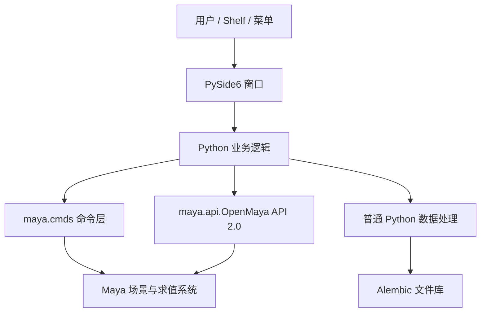

# 1. 先建立 Maya 开发的整体地图

## 1.1 本项目到底是哪一种“插件”

日常把 Shelf 上能点的工具都叫插件，但从开发机制看，这次工具是 **Python 包 + Qt 界面 + Maya 原生命令/API**。它没有注册新的 Maya 节点，也没有实现 initializePlugin。

| 形式 | Maya 如何进入代码 | 用途 | 本项目关系 |
| --- | --- | --- | --- |
| Python/MEL 脚本 | Script Editor、Shelf、菜单、import | 批处理、流程工具、界面 | 本工具属于这里 |
| Python API 插件 | loadPlugin → initializePlugin | 注册命令、节点等 | 第 6 章给一个 MPxCommand 示例 |
| C++ API 插件 | 加载编译库 → initializePlugin | 自定义节点、变形器、高性能逻辑 | 可复用你的 C++ 基础 |
| 独立 mayapy 程序 | 启动 mayapy；需要场景时初始化 standalone | 无界面测试、离线处理 | 本项目测试方式之一 |

**Python 并不只能写脚本；C++ 也并不只用于自定义节点。** 两种语言都可以通过 API 编写正式插件。正式命令插件的注册/注销入口见 [Autodesk 命令插件说明](https://help.autodesk.com/cloudhelp/2019/ENU/Maya-SDK-MERGED/developer/Maya-Python-API/Maya-Python-Plug-in-Learning/Command-Plug-in-Basics/Command-Plug-ins.html)。

Windows 的 C++ Maya 插件通常是 `.mll`。Python 命令插件仍然可以是一个 `.py` 文件。文件后缀不足以判断某个 `.py` 是普通工具还是注册型插件，要看加载方式和入口。

## 1.2 四个接口层，不是四选一

- `maya.cmds`：按命令做事，比如查询节点、选择对象、调用转换。类似在 Python 中调用 Maya 的命令服务。
- `maya.api.OpenMaya`：以对象句柄、函数集、Plug 等方式访问数据。适合需要更多控制或减少大量命令调用的地方。
- PySide6：负责按钮、布局和事件，不负责理解 XGen。
- 普通 Python/文件库：数组、压缩、验证和文件写入，本来就不必与 Maya 场景耦合。

本工具同时用 cmds 和 API 是合理分工，不需要为了“更专业”把所有 cmds 重写为 API。

## 1.3 哪些对象由谁拥有

| 对象 | 主要所有者/生命周期 | C++ 类比 |
| --- | --- | --- |
| 场景里的 transform、shape、DG 节点 | Maya 场景 | 引擎管理的对象 |
| MObject / MDagPath / MPlug | 引用 Maya 对象或路径的 API 包装 | 句柄/路径，不是你拥有的裸内存 |
| SplineData 的数组 | Python 工具 | 工具自己的数据缓冲 |
| QDialog | Python 引用 + Qt 父子关系 | QObject 所有权体系 |
| Alembic archive | Python 包装的原生对象 | 带资源生命周期的库对象 |

不要因为 Python 变量还存在，就认为它指向的 Maya 节点仍然有效；节点可能已经被用户删除。不要把 `del node_name` 当成删除场景节点，它只删除一个 Python 名字。场景删除要调用 Maya 操作。

## 1.4 什么时候升级为正式插件

以下问题可以帮助选择路线：

- “把当前 XGen 数据导出到磁盘”：像本项目这样写工具通常足够。
- “希望团队能通过一个 Maya 命令调用统计功能”：可以注册 MPxCommand。
- “输入几何改变后，输出必须作为场景图的一部分自动重新求值”：考虑 MPxNode / 变形器等。
- “遍历数百万数据，Python 部分经分析确实成为瓶颈”：再考虑 C++ 或向量化。

C++ 不会自动让错误的数据流程正确，也不意味着所有 Maya API 都线程安全。本工具重的部分已有 XGen、zlib 和 Alembic 原生实现参与；先测量瓶颈，再选择迁移哪一层。

## 1.5 当前项目没有覆盖的方向

Maya 开发还包括 Viewport 2.0 绘制、工具上下文、自定义文件格式、渲染集成、设备接入、变形器、求值管理和缓存。它们都共享一些基础概念：注册生命周期、场景数据、资源所有权、线程边界、版本依赖。学会本项目后，你有了阅读这些专题的入口，而不是已经完成全部 Maya SDK。
