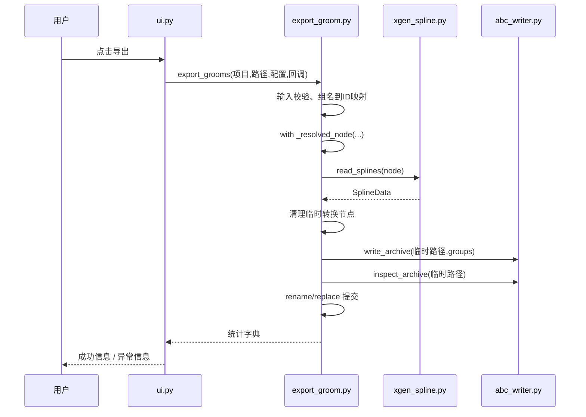

# 3. 从点击按钮跟踪到 ABC 文件

本章按函数调用顺序阅读源码。先不进入压缩数据内部。

## 3.1 总调用链



## 3.2 入口不是主函数

读 `__init__.py::show()`。它只是转发到 UI。Maya 已经运行了 Python 和 Qt 主循环，因此这里不需要 C++ 程序那样的 main，也不应自行启动第二个 QApplication。

再读 `ui.py::show()`：模块变量 `_window` 保留包装对象，窗口存在就显示它；Qt 底层窗口已销毁时，旧包装对象调用可能抛 RuntimeError，此时重新构造。

## 3.3 UI 只收集意图

`GroomWindow.refresh()` 找到描述，把真实 DAG 路径存入 `UserRole`，界面显示较短标签。这个区分很重要：两个人都叫“头发”不代表是同一个节点。

`GroomWindow.export()` 把勾选行转换成 `ExportItem`，把复选框转换成 `ExportOptions`。到此，业务函数只看到普通对象、字符串和函数回调，看不到具体 Qt 表格。

**动手检查**：在调用 export_grooms 之前打断点或临时 print(selected)，你应看到 ExportItem 列表，而不是 Maya 曲线数组。这一层表达的是“用户要导出什么”。

## 3.4 流程层守住边界

`export_grooms()` 依次检查：选择是否为空、是否重复、路径后缀、父目录、覆盖策略。不要等生成了几百万浮点数，才发现目标目录不存在。

组名映射 `ids` 独立于 Maya 的二进制存储分组。一个是用户希望 UE 看到的 Group ID，一个是 XGen 存储格式中的块组织，它们不是同一概念。

传统 XGen 通过 `_resolved_node()` 临时转换为能读取的描述。该 with 块结束后，流程层拿到的是自己的 SplineData，即使临时描述随后删除，导出仍可继续。

## 3.5 数据对象是核心接缝

```python
positions = [0, 0, 0, 0, 1, 0,  2, 0, 0, 2, 1, 0, 2, 2, 0]
counts = [2, 3]
root_uvs = [0.2, 0.3, 0.6, 0.7]
widths = [0.01, 0.005, 0.01, 0.007, 0.002]
```

两根发丝、共五个点。三维位置长度为 15，根 UV 长度为 4，宽度长度为 5。第二根的起点不是 positions[2]，而是 positions[2*3]，因为 counts 按点计数、positions 按标量保存。

把这些约定集中在 SplineData 和验证函数中，UI、Maya 数据读取和 Alembic 写入就不需要互相知道全部细节。以后替换另一种毛发来源，只要也能产生相同契约的数据，就能复用写入层。

## 3.6 写文件不是调用一次 save

`write_archive()` 为每个描述写一个 ICurves 节点，并输出静态 sample。`_write_group()` 负责位置、拓扑、阶数、knot、UV、宽度和 groom 扩展属性。

几个容易混淆的概念：

- `uniform` 是每条曲线一份数据，不是“所有数据的值都相同”。
- `vertex` 是每个点一份数据。
- `groom_guide` 是语义标记，不是“勾上就自动帮你生成引导线”。
- 三次曲线的 degree 是 3，order 是 4；文件格式使用的 knot 数量约定需与接收端匹配。
- `_cubic()` 只特殊处理不足四点的曲线，不会把正常十点发丝自动细分成几十点。

随后 `inspect_archive()` 回读拓扑和属性作用域。回读不等于完成视觉验证：文件字段正确，仍可能存在错误坐标、过粗宽度、错误材质或接收端解释差异。

## 3.7 为什么先写临时文件

如果直接打开用户的旧 ABC 写新内容，中途失败会损坏旧文件。本工具先在相同目录写临时文件，再验证，最后 replace/rename。这样“提交最终结果”与“构建结果”分开了。

这是文件级保护，不是整个 Maya 场景的事务；也不等于保证断电时所有数据已持久化。低层 `write_archive()` 不负责防覆盖，外部调用应优先使用 export_grooms。

## 3.8 这次项目真实教训

原来的 UE 衣橱校验混入了眼睛、牙齿等 UV 区域，同时未兼容 UV V 方向差异，导致正常头发被误拒绝。修复后发根位置通过验证。这说明跨软件管线的正确性不能只看“导出了一个 .abc”或者“某个接口返回 true”。

遇到问题时按层定位：Maya 求值形状 → SplineData → 文件回读 → UE 实际资产 → 绑定 → 最终材质。每一层保存少量统计（数量、范围、样本值），通常比反复调整导入参数更有效。
